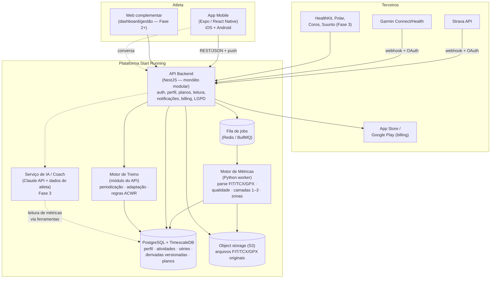

# 01 — Visão geral da arquitetura

## 1. Drivers de arquitetura

Extraídos do SRS, em ordem de força:

1. **PC-1/PC-3 — Ingestão bruta + cálculo canônico.** A série temporal bruta (idealmente o arquivo FIT original) é ingerida e **todas** as métricas derivadas são calculadas internamente com uma única metodologia. Isso exige: armazenamento barato e durável de arquivos brutos, um pipeline assíncrono de processamento e um motor de cálculo isolado e versionável.
2. **Princípio vinculante do SRS §6 — a série bruta é a fonte da verdade.** Métricas derivadas devem ser recomputáveis a partir dela (ADR-0006). Consequência direta: derivadas carregam `methodology_version` e podem ser regeradas em lote sem perda de histórico (RNF-9.2).
3. **PC-5/RNF-7.1 — Qualidade do dado antes de qualquer cálculo.** O pipeline tem um estágio obrigatório de validação/limpeza que produz um **nível de confiança** propagado até a UI.
4. **RNF-1.1 — Feedback da sessão em ≤ 2 minutos.** Define o orçamento de latência do pipeline (ver doc 04) e pede processamento orientado a eventos, não batch noturno.
5. **RNF-2.1 — Picos pós-prova.** Muitos atletas sincronizam ao mesmo tempo; ingestão e cálculo escalam horizontalmente por fila, desacoplados da API de leitura.
6. **RNF-3.x — LGPD.** Dado de saúde é sensível: consentimento granular, criptografia, exclusão e portabilidade são requisitos de arquitetura, não features (doc 06).
7. **RNF-6.1 — iOS e Android com paridade.** Uma base de código cliente (React Native/Expo, ADR-0002) com o design system compartilhado via `packages/design-tokens`.
8. **Roadmap faseado sem retrabalho (SRS §7).** O backend nasce **monólito modular** com fronteiras de módulo alinhadas aos épicos do SRS; módulos podem ser extraídos para serviços quando escala ou equipe justificarem (ADR-0003).

## 2. Diagrama de contêineres (C4 nível 2)



**Fluxo essencial (SRS §6):** dispositivo → conector → normalização → qualidade de dado → motor de métricas (canônico) → motor de treino → apresentação/coach → feedback e ajuste → volta ao atleta.

## 3. Stack

| Camada | Escolha | Justificativa (ADR) |
|---|---|---|
| Mobile | **React Native + Expo (TypeScript)**, Expo Router | Paridade iOS/Android com uma base (RNF-6.1); ecossistema maduro de push, OAuth e billing; web complementar reaproveita componentes (ADR-0002) |
| Web complementar | Expo Web / React (Fase 2+) | Reuso de componentes e tokens |
| Backend API | **NestJS (Node/TypeScript)** | Monólito modular com fronteiras explícitas por módulo do SRS; DI e testabilidade; mesma linguagem do domínio compartilhado (ADR-0003) |
| Motor de métricas | **Python 3.12** (worker) | Ecossistema de processamento de sinal e parsing FIT (`fitdecode`, `numpy`, `pandas`); isola o núcleo do diferencial competitivo em um serviço versionável (ADR-0004) |
| Fila | **Redis + BullMQ** | Jobs assíncronos de ingestão/cálculo; escala horizontal para picos pós-prova (RNF-2.1) |
| Banco | **PostgreSQL 16 + TimescaleDB** | Relacional para domínio; hypertables para séries temporais ponto a ponto (ADR-0005) |
| Arquivos brutos | **Object storage S3-compatível** | FIT/TCX/GPX originais imutáveis — a fonte da verdade (ADR-0006) |
| IA / Coach | **Claude API** com tool use sobre os dados do atleta | RF-9.x; respostas ancoradas em dado real via ferramentas de leitura, nunca inventadas (RN-9.1) |
| Push | Expo Push / FCM / APNs | RF-14.x |
| Billing | StoreKit 2 / Play Billing via **RevenueCat** | RF-16.1 — assinatura via lojas com trial |
| Compartilhado | `packages/domain` (tipos canônicos), `packages/design-tokens` | Um vocabulário entre apps, API e documentação |

## 4. Estrutura do monorepo

pnpm workspaces (ADR-0001). Fronteiras de dependência: `apps/*` e `services/api` dependem de `packages/*`; `packages/*` não dependem de apps/serviços; `services/metrics-engine` (Python) espelha os tipos canônicos de `packages/domain` — qualquer mudança no modelo canônico atualiza os dois lados no mesmo PR.

```
packages/design-tokens   → tokens do DS §11 em CSS e TS; temas claro/escuro
packages/domain          → modelo canônico: atleta, atividade, séries, métricas, zonas, plano
apps/mobile              → Expo; tabs Hoje/Plano/Treinos/Coach/Perfil (DS §7.7)
services/api             → NestJS; módulos = épicos do SRS (doc 03)
services/metrics-engine  → Python; parse + qualidade + camadas 1–3 (doc 04)
```

## 5. Mapeamento para o roadmap (SRS §7)

| Fase | O que entra em produção | Componentes ativados |
|---|---|---|
| **Fase 1 — MVP** | Onboarding, conectores Strava+Garmin (FIT), upload manual, registro manual/sRPE, Camada 1, carga interna básica (TRIMP/sRPE), geração e leitura de plano, fortalecimento básico, assinatura, conta/LGPD | Mobile, API (módulos 1, 2 parcial, 3 parcial, 4, 5, 11, 14 básico, 16, 18), engine (parse+qualidade+Camada 1), fila, PG, S3 |
| **Fase 2 — Carga e prontidão** | CTL/ATL/TSB, ACWR, EF/decoupling, HRV/sono, recalibração de limiares, ajuste diário, prevenção avançada, dashboards de tendência, web | Engine (Camada 3 completa + recalibração), módulos 6, 8, 15 completos, web |
| **Fase 3 — Premium** | Camada 2 (dinâmica/potência), coach conversacional, nutrição, estratégia de prova, comunidade, gamificação, painel do treinador, demais conectores | Serviço de IA/coach, módulos 7, 9, 10, 12, 13, 17, conectores extras |

A arquitetura é a mesma nas três fases; o faseamento ativa módulos e estágios do pipeline, sem redesenho — condição imposta pelo SRS §1.2.
