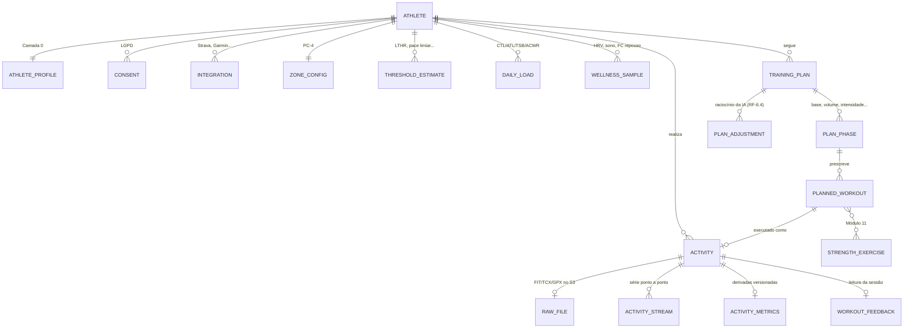

# 02 — Dados e domínio

O modelo físico materializa o **modelo de dados em camadas** do SRS §3.2 e o princípio da **série bruta como fonte da verdade** (SRS §6, ADR-0006). Tipos TypeScript correspondentes vivem em [`packages/domain`](../../packages/domain/); o motor Python espelha o mesmo vocabulário.

## 1. Visão do domínio



## 2. Camadas do SRS → armazenamento

| Camada (SRS §3.2) | Entidades | Armazenamento |
|---|---|---|
| **0 — Perfil** | `athlete_profile`, `threshold_estimate`, `injury_history`, `race_goal` | Postgres relacional |
| **1 — Núcleo universal** | `activity` (agregados), `activity_stream` (ponto a ponto), splits | Postgres + **Timescale hypertable** para streams |
| **2 — Dinâmica/potência** | colunas opcionais de `activity_stream` + agregados em `activity_metrics` | idem; presença depende do sensor (degradação elegante) |
| **3 — Carga e prontidão** | `activity_metrics` (por sessão), `daily_load` (CTL/ATL/TSB/ACWR), `wellness_sample` (HRV/sono/FC repouso) | Postgres, **calculado pela plataforma, nunca importado** (RN-3.1/PC-2) |
| **4 — Subjetivo** | `subjective_log` (sRPE, dor, humor, superfície, calçado) | Postgres |
| Bruto | `raw_file` (FIT/TCX/GPX original, imutável) | **S3** — fonte da verdade |

## 3. Esquema físico (núcleo)

Convenções: `id` UUIDv7, `created_at`/`updated_at` em UTC, soft delete apenas onde a LGPD não exigir apagamento físico (ver doc 06).

### 3.1 Identidade e perfil (Camada 0)

```sql
CREATE TABLE athlete (
  id            uuid PRIMARY KEY,
  email         citext UNIQUE NOT NULL,
  auth_provider text NOT NULL,            -- 'password' | 'apple' | 'google'
  locale        text NOT NULL DEFAULT 'pt-BR',
  units         text NOT NULL DEFAULT 'metric',
  created_at    timestamptz NOT NULL DEFAULT now()
);

CREATE TABLE athlete_profile (
  athlete_id      uuid PRIMARY KEY REFERENCES athlete(id),
  birth_date      date,
  sex             text,
  height_cm       numeric(5,1),
  weight_kg       numeric(5,2),
  hr_rest         smallint,
  hr_max          smallint,
  hr_max_source   text,                   -- 'measured' | 'estimated' (RF-1.3)
  lthr            smallint,               -- opcional (RN-1.2)
  threshold_pace_s_per_km smallint,
  vo2max          numeric(4,1),
  critical_speed_m_s numeric(5,3),
  critical_power_w   smallint,
  self_level      text NOT NULL,          -- 'beginner' | 'intermediate' | 'competitive'
  weekly_volume_km   numeric(6,1),
  available_days  smallint[] NOT NULL,    -- dias da semana (RF-1.1)
  parq_passed     boolean,                -- triagem RF-1.5
  parq_answers    jsonb,
  updated_at      timestamptz NOT NULL DEFAULT now()
);

CREATE TABLE injury_history (              -- RF-1.4: impacto direto na prescrição
  id uuid PRIMARY KEY, athlete_id uuid REFERENCES athlete(id),
  body_region text NOT NULL, description text,
  occurred_at date, resolved boolean NOT NULL DEFAULT false,
  restrictions jsonb                       -- regras que o motor de treino respeita
);

CREATE TABLE race_goal (                   -- prova-alvo (RF-1.1, Módulo 10)
  id uuid PRIMARY KEY, athlete_id uuid REFERENCES athlete(id),
  distance_m integer NOT NULL,             -- 5000 … ultra
  race_date date NOT NULL,
  target_time_s integer, race_name text,
  is_primary boolean NOT NULL DEFAULT true
);
```

### 3.2 Zonas configuráveis (PC-4 / RF-3.9)

```sql
CREATE TABLE zone_config (
  athlete_id  uuid PRIMARY KEY REFERENCES athlete(id),
  model       smallint NOT NULL DEFAULT 5,      -- 3 | 5 | 7
  anchor      text NOT NULL DEFAULT 'pct_lthr', -- 'pct_hrmax' | 'karvonen_pct_hrr'
                                                -- | 'pct_lthr' | 'pct_threshold_pace'
                                                -- | 'pct_critical_power'
  boundaries  jsonb NOT NULL,                   -- limites por zona derivados da âncora
  updated_at  timestamptz NOT NULL DEFAULT now()
);

CREATE TABLE threshold_estimate (               -- recalibração RF-3.10
  id uuid PRIMARY KEY, athlete_id uuid REFERENCES athlete(id),
  kind text NOT NULL,                           -- 'lthr' | 'threshold_pace' | 'cs' | 'cp' | 'hr_max'
  value numeric NOT NULL,
  source text NOT NULL,                         -- 'onboarding' | 'field_test' | 'auto_recalibration'
  confidence real NOT NULL,                     -- 0..1
  effective_at timestamptz NOT NULL,
  methodology_version text NOT NULL
);
```

O padrão para atleta com limiar conhecido é `pct_lthr`/`pct_threshold_pace`; sem limiar, o sistema inicia em `pct_hrmax` estimado e migra automaticamente quando a recalibração (RF-3.10) produzir um limiar confiável.

### 3.3 Atividades e séries brutas (Camadas 1–2)

```sql
CREATE TABLE activity (
  id            uuid PRIMARY KEY,
  athlete_id    uuid NOT NULL REFERENCES athlete(id),
  started_at    timestamptz NOT NULL,
  timezone      text,
  sport         text NOT NULL DEFAULT 'run',
  source        text NOT NULL,                 -- 'strava' | 'garmin' | 'upload' | 'manual'
  source_activity_id text,                     -- id externo p/ dedup (RF-2.6)
  device        text,
  hr_sensor     text,                          -- 'chest_strap' | 'optical' | 'none' (RN-2.2)
  dedup_key     text NOT NULL,                 -- athlete + janela temporal + distância
  richness_rank smallint NOT NULL,             -- FIT(3) > TCX(2) > GPX(1) > resumo(0) (RF-2.7)
  status        text NOT NULL DEFAULT 'ingested', -- 'ingested'|'processing'|'ready'|'rejected'
  -- agregados Camada 1 (preenchidos pelo motor)
  distance_m integer, elapsed_s integer, moving_s integer,
  avg_pace_s_per_km smallint, avg_hr smallint, max_hr smallint,
  avg_cadence_spm smallint, elevation_gain_m smallint, avg_temp_c smallint,
  UNIQUE (athlete_id, dedup_key)
);

CREATE TABLE raw_file (
  id uuid PRIMARY KEY, activity_id uuid REFERENCES activity(id),
  format text NOT NULL,                        -- 'fit' | 'tcx' | 'gpx'
  s3_key text NOT NULL, sha256 text NOT NULL UNIQUE,
  size_bytes bigint, received_at timestamptz NOT NULL
);

-- Série ponto a ponto — Timescale hypertable particionada por tempo
CREATE TABLE activity_stream (
  activity_id uuid NOT NULL,
  athlete_id  uuid NOT NULL,
  ts          timestamptz NOT NULL,
  -- Camada 1
  lat double precision, lon double precision,
  distance_m real, pace_s_per_km real, hr smallint,
  cadence_spm smallint, altitude_m real, grade_pct real, temp_c real,
  -- Camada 2 (opcional por sensor)
  power_w smallint, gct_ms smallint, gct_balance_pct real,
  vertical_osc_mm real, stride_len_m real,
  -- Qualidade (PC-5)
  quality_flags smallint NOT NULL DEFAULT 0,   -- bitmask: spike, interpolado, gap, drift
  PRIMARY KEY (activity_id, ts)
);
SELECT create_hypertable('activity_stream', 'ts');
```

### 3.4 Métricas derivadas versionadas (Camada 3 / RNF-9.2)

Derivadas **nunca** sobrescrevem o bruto e sempre carregam `methodology_version` + confiança (RN-3.2, RNF-7.1). Reprocessar = inserir nova versão e apontar a "corrente"; histórico auditável.

```sql
CREATE TABLE activity_metrics (
  id uuid PRIMARY KEY,
  activity_id uuid NOT NULL REFERENCES activity(id),
  methodology_version text NOT NULL,           -- ex.: 'engine-2026.07'
  is_current boolean NOT NULL DEFAULT true,
  confidence real NOT NULL,                    -- agregado do pipeline PC-5
  confidence_notes jsonb,                      -- por métrica: fonte FC, % interpolado…
  computed_at timestamptz NOT NULL,
  splits jsonb NOT NULL,                       -- por km: pace, FC, GAP, elevação
  time_in_zone jsonb NOT NULL,                 -- s por zona, conforme zone_config vigente
  gap_avg_s_per_km smallint,
  trimp real, rtss real, hrtss real, srpe_load real,
  efficiency_factor real, decoupling_pct real, -- RF-3.6
  normalized_power_w smallint,                 -- Camada 2 (RF-3.8)
  UNIQUE (activity_id, methodology_version)
);

CREATE TABLE daily_load (                      -- RF-3.4 / RF-3.5
  athlete_id uuid NOT NULL REFERENCES athlete(id),
  day date NOT NULL,
  methodology_version text NOT NULL,
  ctl real, atl real, tsb real,                -- ~42d / ~7d / CTL−ATL
  acwr real,                                   -- alerta fora de ~0,8–1,3
  daily_load real NOT NULL DEFAULT 0,
  PRIMARY KEY (athlete_id, day, methodology_version)
);

CREATE TABLE wellness_sample (                 -- RF-3.7
  athlete_id uuid NOT NULL, day date NOT NULL,
  hrv_rmssd real, hrv_baseline real, hrv_deviation real,
  sleep_s integer, hr_rest smallint, spo2_pct real,
  source text NOT NULL, confidence real NOT NULL,
  PRIMARY KEY (athlete_id, day, source)
);

CREATE TABLE subjective_log (                  -- Camada 4 / RF-2.5
  id uuid PRIMARY KEY, athlete_id uuid NOT NULL,
  activity_id uuid, day date NOT NULL,
  srpe smallint,                               -- 0–10
  pain jsonb, mood smallint, stress smallint, motivation smallint,
  surface text, shoe text, notes text
);
```

### 3.5 Planos de treino (Módulos 4, 6, 11)

```sql
CREATE TABLE training_plan (
  id uuid PRIMARY KEY, athlete_id uuid NOT NULL REFERENCES athlete(id),
  race_goal_id uuid REFERENCES race_goal(id),
  status text NOT NULL,                        -- 'active' | 'archived' | 'draft'
  generated_by text NOT NULL,                  -- versão do motor de treino
  created_at timestamptz NOT NULL
);

CREATE TABLE plan_phase (                      -- RF-4.1: base, volume, intensidade, polimento, recuperação
  id uuid PRIMARY KEY, plan_id uuid NOT NULL REFERENCES training_plan(id),
  kind text NOT NULL, starts_on date NOT NULL, ends_on date NOT NULL,
  weekly_volume_target_km numeric(6,1)
);

CREATE TABLE planned_workout (
  id uuid PRIMARY KEY, phase_id uuid NOT NULL REFERENCES plan_phase(id),
  athlete_id uuid NOT NULL,
  scheduled_on date NOT NULL,
  kind text NOT NULL,                          -- 'easy'|'long'|'tempo'|'interval'|'recovery'|'strength'|'race'
  is_key_workout boolean NOT NULL DEFAULT false, -- RF-4.3
  prescription jsonb NOT NULL,                 -- estrutura: blocos, zonas-alvo (FC ou pace), duração/distância
  status text NOT NULL DEFAULT 'planned',      -- 'planned'|'completed'|'missed'|'moved'|'skipped'
  executed_activity_id uuid REFERENCES activity(id)  -- match p/ RF-5.1
);

CREATE TABLE plan_adjustment (                 -- RF-6.4: transparência do ajuste
  id uuid PRIMARY KEY, plan_id uuid NOT NULL,
  trigger text NOT NULL,                       -- 'weekly_review'|'readiness'|'missed_workout'|'user_request'
  reasoning text NOT NULL,                     -- "raciocínio da IA" exibido ao atleta
  diff jsonb NOT NULL,                         -- antes/depois
  athlete_decision text,                       -- 'accepted'|'rejected'|null (RN-6.2)
  created_at timestamptz NOT NULL
);

CREATE TABLE strength_exercise (               -- Módulo 11
  id uuid PRIMARY KEY, slug text UNIQUE NOT NULL,
  name text NOT NULL, category text NOT NULL,  -- 'strength'|'proprioception'|'plyometrics'
  video_url text, description text, contraindications jsonb
);
```

### 3.6 Plataforma (Módulos 14, 16, 18)

`integration` (tokens OAuth criptografados — doc 06), `consent` (granular, com finalidade e trilha), `notification_preference`, `subscription` (estado espelhado do RevenueCat), `workout_feedback` (leitura textual+visual da sessão, RF-5.2), `audit_log` (RNF-3.5).

## 4. Regras transversais do modelo

- **Dedup (RF-2.6):** `dedup_key = athlete_id + faixa de started_at (±3 min) + distância (±2%)`; chegando duplicata, vence a de maior `richness_rank` e a outra é anexada como fonte secundária.
- **Reprocessamento (RNF-2.3):** jobs idempotentes por `sha256` do arquivo; upsert de `activity_metrics` por `(activity_id, methodology_version)`; `daily_load` é recomputado de forma determinística a partir das sessões do período.
- **Degradação elegante (SRS §3.2):** toda coluna de Camada 2–3 é anulável; a UI e o motor de treino consultam a *presença* do dado, nunca presumem.
- **Confiança em todo lugar (RNF-7.1):** `confidence` acompanha qualquer derivada, do banco ao componente de UI (hachura/opacidade — DS §7.6).

## Multiesporte (PC-6 / ADR-0007)

- **`sport` é dimensão de primeira classe** (`run | swim | strength`) em `activities` e em toda derivada; o modelo canônico ganhou `swim.ts` (piscinas, SWOLF, CSS) e `strength.ts` (sessão estruturada, tonelagem, 1RM) — espelhados em `metrics_engine.metrics.swim/strength`.
- **Natação:** série canônica ganha o canal `pace_s_per_100m`; agregados por piscina (`SwimLength`) vêm das mensagens `length` do FIT. Pace/SWOLF são por comprimento de piscina (RN-19.1). Limiar do nado = `css_s_per_100m` na Camada 0, âncora `pct_css` no motor de zonas.
- **Musculação:** NÃO tem série temporal obrigatória — o registro estruturado (exercícios/séries/reps/carga) é o bruto, serializado canonicamente e hasheado (RNF-2.3), como o payload HealthKit.
- **Carga unificada:** `daily_load` é do TOTAL do dia com decomposição `by_sport` (jsonb); CTL/ATL/TSB/ACWR não mudam de forma — mudou só a origem das contribuições.
