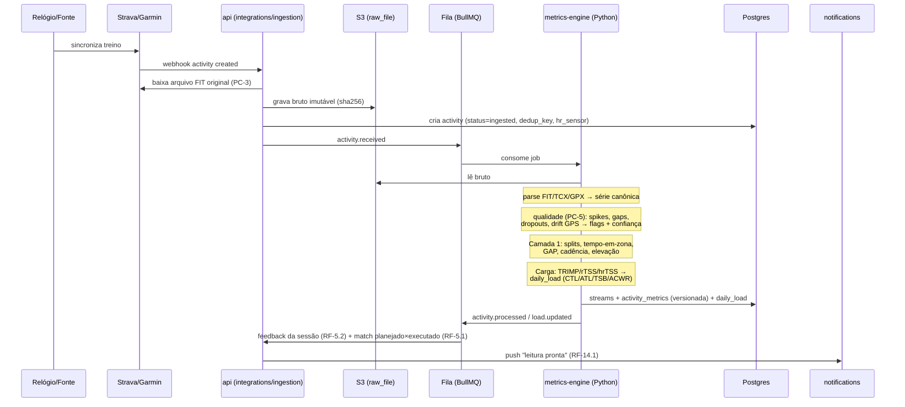

# 04 — Pipeline de ingestão e métricas

O pipeline materializa o fluxo essencial do SRS §6 e concentra o diferencial competitivo (PC-1/PC-5). Implementação: módulo `ingestion` do API (entrada) + `services/metrics-engine` em Python (processamento).

## 1. Sequência (do webhook ao feedback)



**Orçamento de latência (RNF-1.1 — ≤ 2 min no caso típico):**

| Estágio | Alvo |
|---|---|
| Webhook → bruto no S3 + job na fila | ≤ 15 s (inclui download do FIT) |
| Fila → início do processamento | ≤ 10 s (autoscaling de workers por profundidade de fila — RNF-2.1) |
| Parse + qualidade + Camada 1 + carga | ≤ 30 s p/ treino típico (~1h, 1 Hz ≈ 3.600 pontos) |
| Feedback + match + push | ≤ 15 s |
| **Total típico** | **~70 s** (folga p/ pico) |

## 2. Estágios do motor (Python)

Pacote `metrics_engine`, espelhando o vocabulário de `packages/domain`:

```
parsers/     fit.py, tcx.py, gpx.py      → série canônica (riqueza FIT > TCX > GPX, RF-2.4)
quality/     cleaning.py, confidence.py  → PC-5
metrics/     layer1.py                   → splits, tempo-em-zona, GAP, elevação (RF-3.2)
             load.py                     → TRIMP/rTSS/hrTSS, CTL/ATL/TSB, ACWR (RF-3.3–3.5)
             efficiency.py               → EF, decoupling (RF-3.6) — Fase 2
             dynamics.py                 → NP, GCT, osc. vertical (RF-3.8) — Fase 3
zones/       engine.py                   → 3/5/7 zonas, 5 âncoras (PC-4, RF-3.9)
recalibration/thresholds.py              → LTHR/pace de limiar do executado (RF-3.10) — Fase 2
pipeline.py                              → orquestração + methodology_version
```

### 2.1 Qualidade do dado (PC-5) — regras

1. **Fonte de FC**: `chest_strap` confiança base 1,0; `optical` 0,8 (ajustada por variância anômala); sem FC → métricas de carga caem para sRPE (Camada 4).
2. **Spikes**: FC fora de [30, 230] bpm ou salto > 20 bpm/s → remoção + interpolação linear ≤ 5 s; pace física e biomecanicamente impossível (< 2:00/km sustentado fora de declive) → flag.
3. **Gaps**: ≤ 10 s interpola; > 10 s marca segmento `gap` e exclui das médias por zona.
4. **Drift de GPS**: velocidade implícita entre pontos > 12 m/s ou jitter parado → suavização (mediana móvel) + flag; distância oficial prioriza o campo `distance` do dispositivo quando presente.
5. **Confiança agregada** = média ponderada dos sinais (proporção interpolada, fonte FC, densidade de amostragem) → `activity_metrics.confidence`; abaixo de 0,6 a UI exibe o estado "baixa confiança" (DS §7.6) e o motor de treino **não** recalibra limiares com essa sessão (RNF-7.1).

### 2.2 Cálculo canônico — decisões

- **Tempo-em-zona** usa sempre a `zone_config` vigente do atleta; mudar zonas dispara recomputação apenas do tempo-em-zona (barato) sem re-parse.
- **GAP** por modelo de custo de inclinação (Minetti) sobre o grade suavizado.
- **Carga interna por sessão**: hrTSS quando há FC + LTHR; rTSS quando há pace + limiar; TRIMP (Banister) como fallback com FCmax/FCrep; **sRPE** (RPE × minutos) quando só há registro manual — garante que o iniciante sem sensor participa do modelo de carga (RF-2.5).
- **CTL/ATL/TSB**: EWMA com constantes ~42d/~7d; **ACWR**: janela 7d/28d, zona segura 0,8–1,3 com evento `load.updated` alertando saídas (RF-3.5, RF-8.2).
- **Critério de aceite do Módulo 3**: suite de regressão com o mesmo treino gravado em dispositivos distintos; métricas canônicas devem convergir dentro da tolerância definida — roda no CI do engine.

### 2.3 Versionamento da metodologia (RNF-9.2)

- Constante `METHODOLOGY_VERSION` (ex.: `engine-2026.07`) gravada em toda derivada.
- Mudança de fórmula ⇒ nova versão + job `activity.reprocess` em lote (backfill controlado); `is_current` migra quando o backfill do atleta completa. Histórico nunca é sobrescrito.

## 3. Idempotência e deduplicação

- **Idempotência (RNF-2.3):** chave natural = `sha256` do bruto; job repetido curto-circuita. Upsert de derivadas por `(activity_id, methodology_version)`. `daily_load` é função determinística das sessões do período — recomputar nunca duplica.
- **Dedup multi-fonte (RF-2.6):** mesma sessão via Strava e Garmin colide no `dedup_key` (atleta + janela ±3 min + distância ±2%); vence o maior `richness_rank` (FIT > TCX > GPX > resumo). Se o dado mais rico chega **depois**, o RF-2.7 reprocessa e substitui a versão corrente.
- **Registro manual (RF-2.5):** entra no mesmo pipeline com `source='manual'` e só Camada 4 — o modelo de carga usa sRPE.

## 4. Escala (RNF-2.1)

Workers do engine são stateless e escalam por profundidade de fila (picos pós-prova de domingo de manhã). Backpressure: a API nunca processa inline; tudo que passa do estágio "bruto no S3 + job enfileirado" é elástico. Leitura (dashboard) é servida do Postgres já materializado — pico de escrita não degrada leitura.
