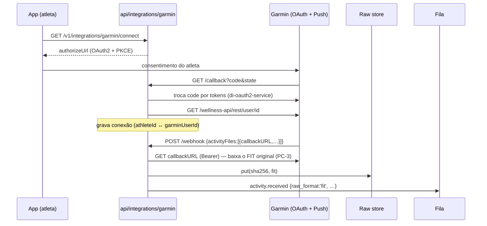
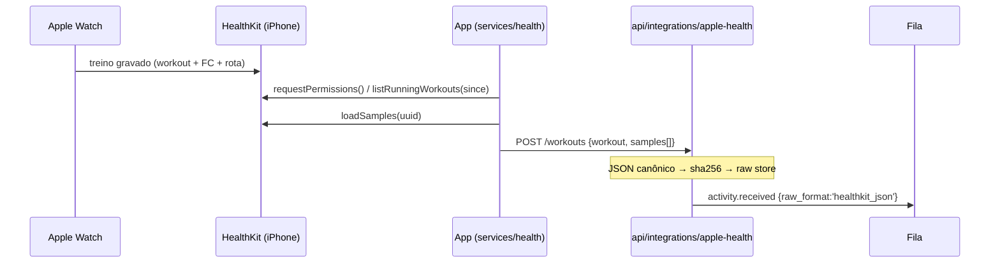

# 08 — Conectores de wearables: Garmin e Apple Watch

Implementação do Módulo 2 do SRS para as duas primeiras fontes de dado real. Código: `services/api/src/modules/integrations/` (API), `apps/mobile/src/services/health/` (app) e `services/metrics-engine/src/metrics_engine/parsers/healthkit.py` (engine).

Princípio comum (PC-1/PC-2/PC-3): o conector **só transporta o bruto**. Nenhuma métrica de fabricante entra; o arquivo/payload original vai imutável para o storage (sha256 = identidade, RNF-2.3) e o metrics-engine deriva tudo.

## 1. Garmin (Garmin Connect Developer Program)

### Fluxo

- **OAuth2 + PKCE**: state de uso único com TTL de 10 min (`OAuthStateStore`); replay é rejeitado.
- **Webhook push**: responde 200 imediato; falha em um item não derruba o lote (Garmin reenvia por até 24 h). `deregistrations` revoga tokens (LGPD).
- **hr_sensor**: chega como `optical`; o engine promove para `chest_strap` quando a mensagem `device_info` do FIT indica cinta (confiança 1.0 — RN-2.2).

### O que falta para produção

| Item | Status |
|---|---|
| Aprovação no [Garmin Connect Developer Program](https://developer.garmin.com/gc-developer-program/) | **pendente — ação de negócio** |
| `GARMIN_CLIENT_ID` / `GARMIN_CLIENT_SECRET` / `GARMIN_REDIRECT_URI` | env vars; sem elas o conector sobe desativado (503 no /connect) |
| Registro da URL do webhook no portal Garmin | após aprovação |
| Adapters Postgres/S3/BullMQ nos tokens `CONNECTION_STORE`/`RAW_FILE_STORE`/`INGEST_QUEUE` | in-memory em dev; troca na composição do módulo |
| Backfill histórico (Activity Backfill API) | Fase 2 |

## 2. Apple Watch (HealthKit)

A Apple **não tem API server-side** de treinos: o dado sai do HealthKit no
iPhone, pelo app. O caminho é o inverso do Garmin — o dispositivo empurra.

- **Contrato do payload**: `apple-health.types.ts` (API) ⟷ `parsers/healthkit.py` (engine) — mudanças sempre no mesmo PR. Riqueza = 2 (equivale a TCX: FC + distância, sem dinâmica).
- **Dedup**: `HKWorkout.uuid` no app (barato) + sha256 do JSON canônico no servidor (definitivo). O mesmo treino que também chegue via Garmin colide no `dedup_key` (RF-2.6) e vence o mais rico (FIT).
- **FC do Watch** = sensor óptico ⇒ confiança base 0,8 no estágio de qualidade.
- **Sync incremental**: `appleHealthSync.ts` mantém `lastSyncedAt` + uuids enviados; primeira execução olha 30 dias.

### O que falta para produção

| Item | Status |
|---|---|
| Dependência nativa `react-native-health` + dev build (não funciona no Expo Go) | implementar `RNHealthAdapter` sobre a interface `HealthKitAdapter` |
| Entitlement `com.apple.developer.healthkit` + `NSHealthShareUsageDescription` | via EAS/prebuild; exige Apple Developer Program |
| Background delivery (HKObserverQuery) para sync automático | Fase 2; MVP sincroniza ao abrir o app |

## 3. Contratos e decisões

- **Endpoints** (prefixo `/v1`, auth Bearer conforme doc 03): `GET integrations/garmin/connect|callback`, `POST integrations/garmin/webhook`, `DELETE integrations/garmin`, `POST integrations/apple-health/register|workouts`, `DELETE integrations/apple-health`, `GET integrations/connections`.
- **Portas** (`ports.ts`): `ConnectionStore`, `RawFileStore`, `IngestQueue`, `OAuthStateStore` — o módulo não conhece Postgres/S3/BullMQ; a composição pluga.
- **Strava** (RF-2.1) entra no mesmo padrão: OAuth2 + webhook em `integrations/strava/`, reaproveitando as mesmas portas. Difere do Garmin por não entregar o FIT original via API oficial — a decisão de riqueza/dedup já contempla (richness `resumo(0)`–`tcx(2)`).
- **LGPD (RNF-3.x)**: desconexão revoga tokens imediatamente; desregistro vindo do provedor também; os brutos permanecem (base legal: execução de contrato) até exclusão de conta, quando o apagamento em cascata os inclui (doc 06).
